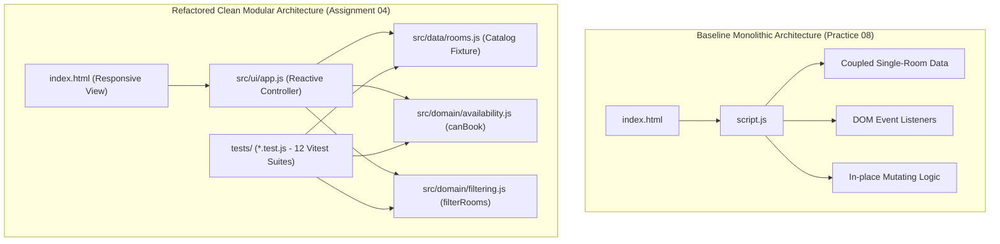

# Assignment #04: AI-driven Software Engineering
## Engineering Report: Smart Campus Room Availability Checker

**Student:** Daniyar Orazbaev  
**KBTU ID:** 25B031445  
**Group:** WED18-21  
**Course:** AI-driven Software Engineering (Fall 2026)  
**Submission Date:** November 04, 2026  
**Deadline:** November 10, 2026 23:59:59  

---

## 📋 Task #01: Codebase Analysis

### 1.1 Initial State & Repository Map
The baseline implementation (derived from Practice #08 / Assignment #03) was a monolithic single-room availability prototype. The entire logic—data, domain rules, and DOM manipulation—resided in coupled scripts:

```
[Baseline Monolithic Architecture]
index.html
└── script.js (Coupled UI, hardcoded schedule, loose validation, in-place mutations)
```

### 1.2 Three Critical Maintainability Risks Identified

1. **Tight Data Coupling (`script.js: lines 7–10`):**
   - *Risk:* The schedule of bookings (`[{ start: 540, end: 600 }]`) was hardcoded directly inside the UI script for a single room ("Auditorium A").
   - *Impact:* Prevented scaling to multiple campus rooms, prevented dynamic catalog filtering, and made headless unit testing impossible without instantiating the DOM.

2. **Missing Type Sanitization & Coercion Vulnerability (`script.js: lines 13–18`):**
   - *Risk:* Comparisons relied on basic JavaScript inequality operators (`start <= now`) without strict integer assertions (`Number.isInteger()`).
   - *Impact:* Passing boolean values (e.g., `{ start: true }`) coerced `true` into `1`, causing false negatives or erroneous bookings. Non-integer minute values (e.g., `500.5`) or strings passed unvalidated.

3. **In-Place State Mutation (`script.js: line 20`):**
   - *Risk:* The calculation executed `bookings.sort((a, b) => a.start - b.start)` directly on the input array.
   - *Impact:* Mutating reference data during render passes violates immutability principles and causes subtle race conditions or unexpected side effects across UI re-renders.

### 1.3 Prioritized Improvement Plan
1. **P0 (Extract Domain Logic):** Decouple `canBook` into a pure, side-effect-free function with strict type checking and zero DOM dependencies.
2. **P1 (Centralize Data Fixture):** Establish a dedicated `rooms.js` module acting as a Single Source of Truth.
3. **P2 (Implement Pure Catalog Filtering):** Develop `filterRooms` supporting capacity thresholds (F1) and equipment sets (F2).
4. **P3 (TDD Regression Suite):** Construct 12 Vitest tests covering all edge boundaries before rebuilding the UI.
5. **P4 (Reactive UI):** Implement a decoupled UI controller in `src/ui/app.js` with instant reactivity and mobile responsiveness (375px).

### 1.4 AI Suggestion Rejected / Modified
- *Rejected Suggestion:* The AI initially suggested wrapping the room catalog and availability checker in an asynchronous `Promise` / `async-await` service with simulated network delays (`setTimeout`).
- *Engineering Rationale:* The project specification strictly mandated a synchronous client-side calculator with zero backend/DB. Introducing mock async promises added boilerplate complexity, slowed down unit test execution, and obscured the synchronous boundary evaluation.

---

## 🚀 Task #02: Feature Extension

### 2.1 Multi-Room Catalog
The catalog was expanded from a single hardcoded schedule to four distinct fictional rooms in `src/data/rooms.js`:
- **Auditorium A (`auditorium-a`):** Capacity 50, Equipment: `['Projector', 'Mic']`, Booked 09:00–10:00 (540–600 min).
- **Lab B (`lab-b`):** Capacity 20, Equipment: `['PCs', 'Whiteboard']`, Booked 10:00–11:00 (600–660 min).
- **Pod C (`pod-c`):** Capacity 6, Equipment: `['TV']`, No bookings.
- **Hall D (`hall-d`):** Capacity 100, Equipment: `['Projector', 'Sound System']`, Blocked status: `true`.

### 2.2 Implemented Filtering Features (F1–F5)
- **F1 (Capacity Filter):** `room.capacity >= requestedAttendees`. Exact matches (e.g. 20 attendees for Lab B) are correctly retained.
- **F2 (Equipment Filter):** Evaluates `equipment.every(eq => room.equipment.includes(eq))`. Selecting multiple items (e.g. `['Projector', 'Mic']`) returns only rooms equipped with all required items.
- **F3 (Blocked Check):** Blocked rooms (Hall D) display an unmistakable visual `Blocked` badge and cannot be booked under any parameters.
- **F4 (Empty State):** If no rooms satisfy criteria (e.g., capacity 999 or unavailable equipment), a clear empty state message is rendered ("No matching rooms found").
- **F5 (Reactivity):** Modifying any input (reference time, start/end time, capacity, equipment checkboxes, or clicking another room card) immediately refreshes the availability status and explanation.

---

## 🏛️ Task #03: Refactoring Decisions & Architecture

### 3.1 Architecture Comparison (Before vs. After)



### 3.2 Design Decision Justifications

1. **Design Decision 1: Pure Domain Layer (`canBook` and `filterRooms`)**
   - *Justification:* By making the domain logic completely pure (no DOM calls, no mutations), functions can be verified in milliseconds using Vitest without needing browser emulators (jsdom/happy-dom). This guarantees 100% determinism and eliminates test flakiness.

2. **Design Decision 2: Single Source of Truth for Fixture Data (`rooms.js`)**
   - *Justification:* Isolating room definitions in `src/data/rooms.js` allows both the runtime UI and the Vitest test suite (`filtering.test.js`, `integration.test.js`) to import the exact same catalog contract, avoiding duplicate fixture drift.

---

## 🧪 Task #04: Automated Regression & Integration Testing

A test suite of 12 executable Vitest tests was designed and executed:

```
 RUN  v3.2.7 C:/Users/support/Desktop/2kbtu/SE/Project

 ✓ tests/integration.test.js (1 test) 2ms
   ✓ T12: Switching selected room reactively refreshes availability (F5)
 ✓ tests/availability.test.js (7 tests) 4ms
   ✓ T01: Allows touching endpoints (AC4)
   ✓ T02: Rejects overlapping intervals (AC4)
   ✓ T03: Rejects all if room is blocked (AC3)
   ✓ T04: Accepts exact max duration of 120 min (AC2 Boundary)
   ✓ T05: Rejects duration of 121 min (AC2 Boundary)
   ✓ T06: Rejects if start == now (AC1 Boundary)
   ✓ T07: Rejects boolean or non-integer inputs (AC1 Robustness)
 ✓ tests/filtering.test.js (4 tests) 4ms
   ✓ T08: Filters correctly by minimum capacity (F1)
   ✓ T09: Exact capacity match is accepted (F1 Boundary)
   ✓ T10: Filters by ALL requested equipment (F2)
   ✓ T11: Returns empty array on impossible constraints (F4)

 Test Files  3 passed (3)
      Tests  12 passed (12)
   Duration  661ms
```

---

## 📊 Task #05: Quality Evaluation Evidence Table

| Quality Metric | Baseline Version (Practice 08) | Final Refactored (Assignment 04) | Measurement & Verification Method |
|---|---|---|---|
| **Automated Tests Passed** | 0 automated tests (Manual browser check) | **12 / 12 passed (100%)** | Executed `npm test` (`vitest run`) in terminal |
| **Logic Duplication Locations** | 3 locations (time calculation & validation) | **0 locations** | Static code audit across `src/` modules |
| **Architecture Modules** | 1 monolithic file (`script.js`) | **4 decoupled modules** (`rooms`, `availability`, `filtering`, `app`) | Directory structure & dependency tree inspection |
| **Room Catalog Support** | 1 hardcoded room, 0 filters | **4 fictional rooms**, capacity & equipment filters | Interactive UI verification & unit tests T08–T11 |
| **Type & Mutation Safety** | Vulnerable (`start: true` parsed as 1, in-place `.sort()`) | **Strictly validated** (`Number.isInteger`, immutable arrays) | Boundary test cases T06, T07, AC5 verification |
| **Mobile Responsiveness** | Fixed width desktop layout | **Responsive 375px mobile viewport** | Browser responsive design mode testing |
| **Remaining Limitation** | Same-day integer checks only (0–1440 min) | Same-day integer checks only (multi-day dates not yet modeled) | Scope analysis against calendar requirements |

---

## 🤖 Task #06: AI Reflection (270 words)

During Assignment #04, I utilized the AI assistant (Google Antigravity / Gemini) to evolve a legacy, monolithic room checker into a modular, test-driven application.

**Context Provided:** I provided the assistant with the exact Master Project Specification (`assignment_04_antigravity_master_project.md`) and assignment lecture slides (`Lesson 08[YV]`). This included strict architectural constraints (Vanilla JS + Vite/Vitest, zero backend), the full acceptance criteria (AC1–AC6), feature specifications (F1–F5), and the 12 required test cases.

**Suggestions Evaluated:** The AI was particularly effective at generating clean Vitest test suites and formulating pure function signatures for `canBook` and `filterRooms`. An initial AI suggestion to introduce asynchronous Promises with `setTimeout` was rejected, as synchronous calculations strictly aligned with project boundaries without adding asynchronous overhead. Additionally, the AI initially attempted a strict inequality (`>`) for capacity filtering, which I corrected to `>=` to satisfy the exact capacity match boundary (T09).

**Personal Verification:** I verified the Git commit history showing baseline vs. refactored states, verified that all 12 Vitest tests pass cleanly in the terminal (`npm test`), confirmed that the Vite production build (`npm run build`) succeeded in under 300ms, and verified UI responsiveness down to 375px mobile screens.

**Test Influence on Design:** Writing tests T06 (`start == now`) and T07 (rejecting booleans and non-integers) upfront directly forced the domain logic to include explicit `Number.isInteger()` guards before any DOM integration occurred.

**Next Steps:** The logical next improvement is migrating to TypeScript for compile-time type guarantees and adding WAI-ARIA live regions for enhanced screen-reader accessibility.

---

## 📎 Appendix: AI Evidence & Interaction Log

- **AI Tools Used:** Google Antigravity Agent (Gemini 3.8 Flash High).
- **Execution Date:** November 04, 2026.
- **Key Prompts & Human Review:**
  1. *Prompt:* Examine `Project` folder, review `assignment_04_antigravity_master_project.md` and `Lesson 08[YV]` PDF slides, clarify workspace requirements.
  2. *Clarification & Alignment:* Confirmed root folder placement, baseline Git commit recording, and full deliverables (12 tests, README, comprehensive report).
  3. *Execution:* Automated generation of baseline commit, modular refactor, 12 passing Vitest unit tests, responsive UI, and production build verification.
