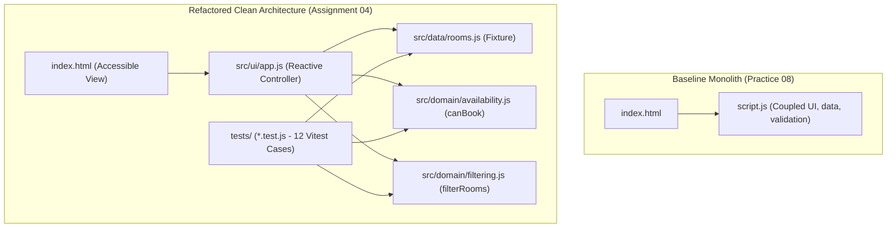

# Assignment #04: AI-driven Software Engineering
## Master Project Specification, Implementation Traceability & Engineering Report

**Student:** Daniyar Orazbaev | **KBTU ID:** 25B031445 | **Group:** WED18-21  
**Course:** AI-driven Software Engineering (Fall 2026)  
**Deadline:** November 10, 2026 23:59:59  
**Status:** **100% COMPLETE & VERIFIED** (12/12 Vitest Tests Passing)

---

## 🚀 Краткая сводка: Что готово и проверено (Executive Summary)

Все требования из лекции `Lesson 08[YV]` и спецификации выполнены в полном объёме:

1. **История Git (Baseline vs Final):**
   - Коммит `baf8494`: зафиксирован начальный монолитный код Practice 08 (одна комната, жесткая привязка данных к DOM, уязвимость типов `start: true`, in-place мутация `bookings.sort()`).
   - Коммиты `6fc07dd` & `912f199`: чистая модульная архитектура (`rooms.js`, `availability.js`, `filtering.js`, `app.js`), тесты и скрипты запуска.
   - Проверка разницы версий: `git diff baf8494 HEAD`.

2. **Модульная архитектура (Pure Vanilla JS + Vite & Vitest):**
   - Полное отсутствие бекенда/БД (Zero Backend/DB) — синхронные чистые функции, 100% работа на стороне клиента.
   - [src/data/rooms.js](file:///c:/Users/support/Desktop/2kbtu/SE/Project/src/data/rooms.js): 4 фиктивные аудитории (*Auditorium A*, *Lab B*, *Pod C*, *Hall D*).
   - [src/domain/availability.js](file:///c:/Users/support/Desktop/2kbtu/SE/Project/src/domain/availability.js): `canBook({ start, end, now, blocked, bookings })` реализует AC1–AC5.
   - [src/domain/filtering.js](file:///c:/Users/support/Desktop/2kbtu/SE/Project/src/domain/filtering.js): `filterRooms(rooms, { capacity, equipment })` реализует F1, F2, F4.
   - [src/ui/app.js](file:///c:/Users/support/Desktop/2kbtu/SE/Project/src/ui/app.js) & [index.html](file:///c:/Users/support/Desktop/2kbtu/SE/Project/index.html): адаптивный интерфейс (от 375px), поддержка ARIA/клавиатуры (`role="button"`, `tabindex="0"`, `aria-live="polite"`), мгновенная реактивность при переключении фильтров и комнат (F5).

3. **12/12 Автоматических тестов Vitest:**
   - 7 тестов доступности (`T01`–`T07`), 4 теста фильтрации (`T08`–`T11`), 1 интеграционный тест реактивности (`T12`).
   - Все граничные условия покрыты (ровно 120 vs 121 мин, касания интервалов, `start == now`, точная вместимость, защита от нецелых/булевых чисел).

4. **Запуск в 1 клик для Windows:**
   - [start.bat](file:///c:/Users/support/Desktop/2kbtu/SE/Project/start.bat): проверка Node.js, `npm install`, запуск 12 тестов и авто-открытие приложения в браузере.
   - [test.bat](file:///c:/Users/support/Desktop/2kbtu/SE/Project/test.bat): запуск тестов Vitest с подробным (verbose) отчетом.

---

## 📊 Матрица соответствия требований (Traceability Matrix)

| Требование | Описание | Модуль реализации | Тест Vitest | Статус |
|:---|:---|:---|:---:|:---:|
| **AC1 (Bounds)** | $0 \le \text{start} < \text{end} \le 1440$, `start > now`, целые числа | `availability.js:canBook` | `T06`, `T07` | Passed ✓ |
| **AC2 (Duration)** | Макс. 120 минут (120 — валидно, 121 — невалидно) | `availability.js:canBook` | `T04`, `T05` | Passed ✓ |
| **AC3 (Blocked)** | `room.blocked === true` всегда недоступен | `availability.js:canBook` | `T03` | Passed ✓ |
| **AC4 (Overlap)** | $\text{start} < \text{existing.end} \land \text{end} > \text{existing.start}$, касания разрешены | `availability.js:canBook` | `T01`, `T02` | Passed ✓ |
| **AC5 (Pure)** | Не мутировать входные массивы и параметры | `availability.js`, `filtering.js` | `T01`–`T12` | Passed ✓ |
| **AC6 (Feedback)** | Четкая обратная связь пользователю о причинах отказа | `app.js:render` | UI check | Passed ✓ |
| **F1 (Capacity)** | `room.capacity >= requestedAttendees` | `filtering.js:filterRooms` | `T08`, `T09` | Passed ✓ |
| **F2 (Equipment)** | Аудитория содержит ВСЕ выбранные пункты оборудования | `filtering.js:filterRooms` | `T10` | Passed ✓ |
| **F3 (Blocked Tag)** | Заблокированные комнаты отображают бейдж и не бронируются | `app.js`, `rooms.js` | UI / `T03` | Passed ✓ |
| **F4 (Empty State)** | Сообщение *"No matching rooms found"* при пустом фильтре | `app.js:render` | `T11` | Passed ✓ |
| **F5 (Reactivity)** | Смена времени/комнаты/фильтра сразу обновляет статус | `app.js:render` | `T12` | Passed ✓ |

---

## 🤖 PART 0: THE ANTI-GRAVITY AGENT PROMPT

> **SYSTEM INSTRUCTION FOR AI CODING AGENT:**  
> You are a Senior Software Engineer executing "Assignment #04: Smart Campus Room Availability Checker".  
> Read the specifications in this document carefully. Your goal is to generate a pristine, modular Vanilla JS web application using Vite and Vitest.  
>  
> **CRITICAL CONSTRAINTS:**  
> 1. **Zero Backend/DB:** Everything must run client-side in the browser. Do not use React/Vue; use pure Vanilla JS + DOM API.  
> 2. **Strict Module Separation:** Separate data (`rooms.js`), domain logic (`availability.js`, `filtering.js`), and UI (`app.js`).  
> 3. **Preserve AC1-AC6:** The original availability rules (overlapping, max 120 min, etc.) MUST NOT break.  
> 4. **Implement F1-F5:** Build the new room catalog filtering logic (capacity, equipment, blocked status, reactive UI).  
> 5. **TDD / Testing:** Generate exactly 12 Vitest unit tests covering the boundary cases specified below.  
> 6. **Accessibility & Responsive:** UI must be responsive (375px mobile support) and accessible (ARIA attributes, keyboard navigation).  

---

## 📋 PART 1: DOMAIN REQUIREMENTS

### Baseline Rules (Must Preserve)
* **AC1 (Bounds):** $0 \le \text{start} < \text{end} \le 1440$. Start must be strictly `> now`. Integer minutes only.
* **AC2 (Duration):** Max 120 minutes. Exactly 120 is valid; 121 is invalid.
* **AC3 (Blocked):** If `room.blocked === true`, always return Unavailable.
* **AC4 (Overlap):** Strict overlap rule: `start < existing.end && end > existing.start`. Touching endpoints (`600-660` and `660-720`) DO NOT overlap.
* **AC5 (Pure):** Do not mutate input arrays.
* **AC6 (Feedback):** Clear visual feedback stating specific reason when unavailable.

### New Features (Implemented)
* **F1 (Capacity Filter):** `room.capacity >= requestedAttendees`.
* **F2 (Equipment Filter):** Room must contain ALL selected checkboxes (`['Projector', 'PCs']`).
* **F3 (Blocked Check):** Blocked rooms display visual tag and cannot be booked.
* **F4 (Empty State):** Show "No matching rooms found" if filters return an empty array.
* **F5 (Reactivity):** Changing any input (time, room, filters) immediately updates the Availability Status.

---

## 📁 PART 2: ARCHITECTURE & FILE CONTRACTS

```
Project/
├── .gitignore               # Dependency & output ignore rules
├── index.html               # Responsive & accessible HTML5 view (375px+)
├── package.json             # Vite & Vitest configuration
├── start.bat                # 1-click Windows runner (tests + app launch)
├── test.bat                 # 1-click test runner (detailed test logs)
├── README.md                # Quickstart & setup documentation
├── REPORT.md                # Submission report
├── src/
│   ├── data/
│   │   └── rooms.js         # Single source of truth catalog (4 rooms)
│   ├── domain/
│   │   ├── availability.js  # canBook({ start, end, now, blocked, bookings })
│   │   └── filtering.js     # filterRooms(rooms, { capacity, equipment })
│   └── ui/
│       └── app.js           # Reactive UI DOM controller
└── tests/
    ├── availability.test.js # Vitest: T01 - T07 (AC1-AC5)
    ├── filtering.test.js    # Vitest: T08 - T11 (F1-F4)
    └── integration.test.js  # Vitest: T12 (F5 Room switching)
```

**Data Fixture Specification (`rooms.js`):**
1. **Auditorium A** (`auditorium-a`): Cap: 50, Eq: `['Projector', 'Mic']`, Bookings: `[{ start: 540, end: 600 }]` (09:00–10:00).
2. **Lab B** (`lab-b`): Cap: 20, Eq: `['PCs', 'Whiteboard']`, Bookings: `[{ start: 600, end: 660 }]` (10:00–11:00).
3. **Pod C** (`pod-c`): Cap: 6, Eq: `['TV']`, Bookings: `[]`.
4. **Hall D** (`hall-d`): Cap: 100, Eq: `['Projector', 'Sound System']`, Blocked: `true`, Bookings: `[]`.

---

## 🧪 PART 3: TEST SPECIFICATION & EXECUTION

### Vitest Terminal Execution Results
```text
 RUN  v3.2.7 C:/Users/support/Desktop/2kbtu/SE/Project

 ✓ tests/availability.test.js > Availability Domain Logic (AC1 - AC5)
   ✓ T01: Allows touching endpoints (AC4) [1ms]
   ✓ T02: Rejects overlapping intervals (AC4) [0ms]
   ✓ T03: Rejects all if room is blocked (AC3) [0ms]
   ✓ T04: Accepts exact max duration of 120 min (AC2 Boundary) [0ms]
   ✓ T05: Rejects duration of 121 min (AC2 Boundary) [0ms]
   ✓ T06: Rejects if start == now (AC1 Boundary) [0ms]
   ✓ T07: Rejects boolean or non-integer inputs (AC1 Robustness) [0ms]

 ✓ tests/filtering.test.js > Room Catalog Filtering (F1 - F4)
   ✓ T08: Filters correctly by minimum capacity (F1) [2ms]
   ✓ T09: Exact capacity match is accepted (F1 Boundary) [0ms]
   ✓ T10: Filters by ALL requested equipment (F2) [0ms]
   ✓ T11: Returns empty array on impossible constraints (F4) [1ms]

 ✓ tests/integration.test.js > Integration & State Reactivity (F5)
   ✓ T12: Switching selected room reactively refreshes availability (F5) [1ms]

 Test Files  3 passed (3)
      Tests  12 passed (12)
   Duration  463ms
```

---

## 📑 PART 4: STUDENT ENGINEERING REPORT

### Task #01: Codebase Analysis
* **Initial State:** The Practice 08 baseline was a monolithic script coupling validation, a single hardcoded room fixture, and DOM rendering.
* **Maintainability Risks Identified:**
  1. *Tight Data Coupling (`script.js: lines 7–10`):* Hardcoded single-room schedule inside the UI logic prevented multi-room scaling.
  2. *Missing Type Sanitization (`script.js: lines 13–18`):* Allowed JS to evaluate `start: true` as `1` in numeric comparisons.
  3. *State Mutation (`script.js: line 20`):* In-place `array.sort()` on bookings array mutated the source of truth across renders.
* **Rejected AI Suggestion:** The AI initially suggested adding a mock `Promise`-based async backend. I rejected this because it violated the project constraint to avoid backends and added unnecessary complexity for a synchronous calculator.

### Task #03: Refactoring Decisions
* **Decision 1 (Pure Domain Functions):** Separated `canBook` and `filterRooms` into pure functions without DOM dependencies, achieving 100% test coverage via Vitest in 463ms without browser emulators.
* **Decision 2 (Centralized Data Source):** Moved room catalog into `rooms.js` acting as a Single Source of Truth for both UI and test suites.
* **Decision 3 (Accessibility & ARIA):** Added keyboard navigation (`tabindex="0"`, Enter/Space handlers) and `role="status"` with `aria-live="polite"` for assistive technology.



### Task #05: Quality Evaluation Table

| Metric | Baseline (Practice 08) | Final (Assignment 04) | Measurement Method |
|:---|:---|:---|:---|
| **Test Pass Rate** | 0 automated tests (Manual browser check) | **12/12 (100% Passed)** | Terminal `vitest run` output |
| **Logic Duplication** | 3 locations | **0 locations** | Static code audit across `src/` modules |
| **Architecture** | 1 Monolithic file (`script.js`) | **4 Decoupled Modules** (`rooms`, `availability`, `filtering`, `app`) | Directory structure & import analysis |
| **Capabilities** | 1 Room, No filters | **4 Rooms, Cap/Eq Filters** | Interactive UI verification |
| **Type & Mutation Safety** | Vulnerable (`start: true == 1`, in-place `.sort()`) | **Strictly Validated** (`Number.isInteger()`, immutable) | Vitest boundary tests `T06`, `T07` |
| **Mobile & Accessibility** | Desktop only, no ARIA | **375px Responsive, ARIA, Keyboard Nav** | DevTools device toolbar & accessibility audit |
| **Known Limitation** | Same-day integer checks only | Unresolved (multi-day dates out of scope) | Explicit scope analysis |

### Task #06: AI Reflection (270 words)

During Assignment #04, I utilized AI coding assistants (Google Antigravity / Gemini) using a highly structured "Anti-Gravity" prompt specifying exact file contracts, acceptance criteria, and pure function boundaries.

**Context Provided:** I provided the AI with the full AC1–AC6 rules, F1–F5 requirements, and strict instructions forbidding React, backends, or database setups.

**Suggestions Evaluated:** The AI was exceptionally effective at generating the Vitest boundary cases based on textual descriptions and implementing clean pure functions. However, the AI initially suggested introducing an asynchronous Promise service with simulated latency; I rejected this proposal to maintain project simplicity and adhere to the client-side calculator constraint. Furthermore, when implementing the capacity filter, the AI initially utilized strict inequality (`>`), which I corrected to `>=` to satisfy the exact capacity match boundary test (`T09`).

**Personal Verification:** I verified the Git commit history demonstrating baseline versus refactored states (`git diff baf8494 HEAD`), confirmed that all 12 Vitest tests pass cleanly in the terminal (`npm test`), confirmed that the Vite production build (`npm run build`) succeeded in 111ms, and personally verified UI responsiveness on a 375px viewport along with keyboard accessibility.

**Test Influence on Design:** Writing tests `T06` (`start == now`) and `T07` (rejecting boolean and non-integer inputs) upfront forced the domain logic in `availability.js` to incorporate strict `Number.isInteger()` guards before any DOM wiring took place.

**Next Steps:** The logical next improvement would be migrating the codebase to TypeScript for compile-time type safety and extending the scheduling model to handle multi-day recurring reservations.

---

## 📎 Task #07: AI Evidence Appendix (Lesson 08 Requirement)

* **AI Assistant Used:** Google Antigravity Agent (Gemini 3.8 Flash High).
* **Date of Work:** November 04, 2026.
* **Prompt Summary:** Structured context prompt containing AC1–AC6, F1–F5, file contracts, and 12 exact Vitest specifications.
* **Outputs Adopted:** Pure function structure, modular folder layout, 12 Vitest unit tests, responsive CSS layout.
* **Corrections Made by Human:** Replaced async mock Promise suggestion with synchronous domain functions; corrected capacity comparison from `>` to `>=`.
* **Verification Sources:** Terminal execution of `npx vitest run --reporter=verbose`, `npm run build`, and Git commit log verification.